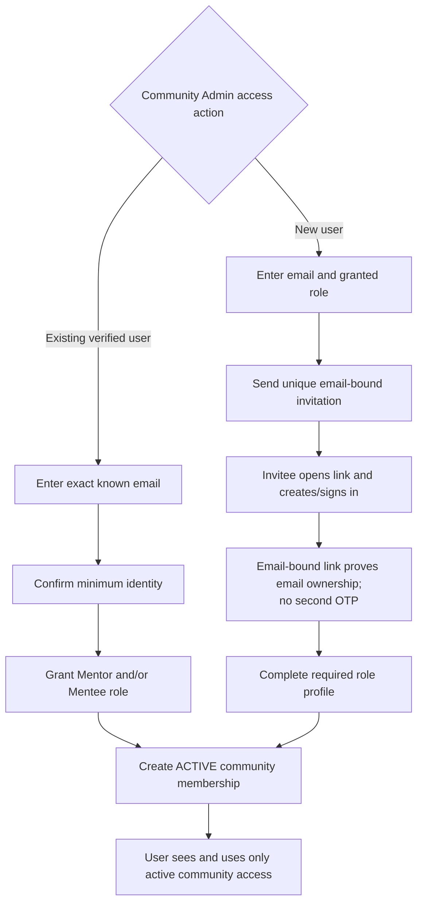

# Email Verification And Community Access

Last updated: 2026-10-03

**Primary readers:** Backend, Frontend, Community Admin
**Priority:** Highest
**Read this when:** You are implementing account creation, email verification, invitations, or Community Admin member access.

## Purpose

This feature governs email ownership verification and community access. Email verification proves control of an address; it does not prove institutional affiliation or automatically grant access to a community.

## Core Rules

- any user may create an OAA account with a supported email address; MMA affiliation and a McGill domain are not platform-wide requirements
- verification uses a six-digit numeric code sent to the entered email address
- code expiry is 10 minutes, codes are single-use, and resending invalidates a prior active code
- one verification record permits up to five failed attempts; one email may request up to three codes in a rolling 15-minute window
- verified email ownership moves the account to `ONBOARDING`; it does not make the account an active member of any community
- an account may be `ACTIVE` at platform level only after required onboarding and at least one active community membership; authorization must always check the requested community membership and role
- personal email is never shown to Community Admins, other users, or matching participants after account creation. A Community Admin may enter an invitee email solely to create a direct member invitation; after submission, the system must not expose the stored address and should show only invitation status

## Community Access Paths

### Existing-account add

- a Community Admin adds a known user with an exact-email lookup; this is not a browseable global user directory
- the lookup returns only the minimal identity necessary to confirm the intended account and never reveals other-community membership or private data
- the Community Admin selects `MENTOR`, `MENTEE`, or both where permitted; the membership becomes `ACTIVE` immediately
- an existing account must already have a verified email identity before it can be added

### Email-bound member invitation

- a Community Admin can create a unique invitation for a known Mentor or Mentee by entering the invitee's email address and selecting the granted role
- the invitation is bound to normalized email, community, requested role, expiry, and revocation state
- only the owner of the invited email may sign in/create an account, accept, and activate the invitation
- opening and accepting the email-bound invitation proves ownership of that email; do not send a second OTP verification challenge for that address
- the invitee completes required role-specific onboarding before their membership becomes `ACTIVE`
- a Community Admin may revoke an unaccepted invitation; acceptance and revocation must be audited
- no public, reusable community join link or general signup-to-community path exists in MVP

## Frontend Requirements

- provide a role-neutral account and email-verification flow for direct account creation outside a community
- show whether the user is accepting an email-bound community invitation and which role it grants
- do not expose communities to a user who has no active membership or valid invitation for them
- show community role and membership status clearly after activation
- block community matching, asks, and coordination until the relevant membership is `ACTIVE`
- do not show community metrics in the MVP Community Admin interface

## Backend Requirements

- normalize email before exact lookup, rate limiting, and invitation matching
- store verified email identities separately from `User`; a person may retain multiple verified email identities
- model `Community`, `CommunityMembership`, `CommunityMembershipRole`, and `Invitation` explicitly
- enforce unique email-bound invite acceptance and prevent a forwarded invitation from activating a different email
- persist membership status, granted role, source (`ADMIN_ADD` or `DIRECT_INVITE`), actor, timestamps, and invitation history
- authorize Community Admin actions by the admin's active membership in that community, never by frontend route selection alone
- ensure a Community Admin cannot browse, add, or view members outside their assigned community
- backend manually provisions approved communities and assigns Community Admins from OAA-approved instructions; it does not review ordinary membership applications because MVP has none
- generate verification codes securely and store only code hashes
- record verification purpose, send time, expiry, invalidation, attempt count, and usage timestamps

## Audit And Privacy Requirements

- audit code generation, resend, invalidation, attempt increments, success, and failure
- audit exact-email lookup, invitation creation, email binding, expiry, revocation, acceptance, direct membership add, removal, and role change
- retain only the data necessary for access, support, and audit under the final retention policy
- a community-specific evidence requirement is disabled by default; before enabling it, document collection purpose, reviewer visibility, storage location, retention, deletion, and consent/notice copy

## Open Decisions

- final privacy notice, retention/deletion periods, and consent wording for optional notifications
- invitation expiry duration and whether a Community Admin may reissue an expired invitation
- Community Admin removal/appeal policy and ownership transfer when an admin leaves
- post-MVP Community Admin metrics and any individual-level activity visibility

## Process Flow

