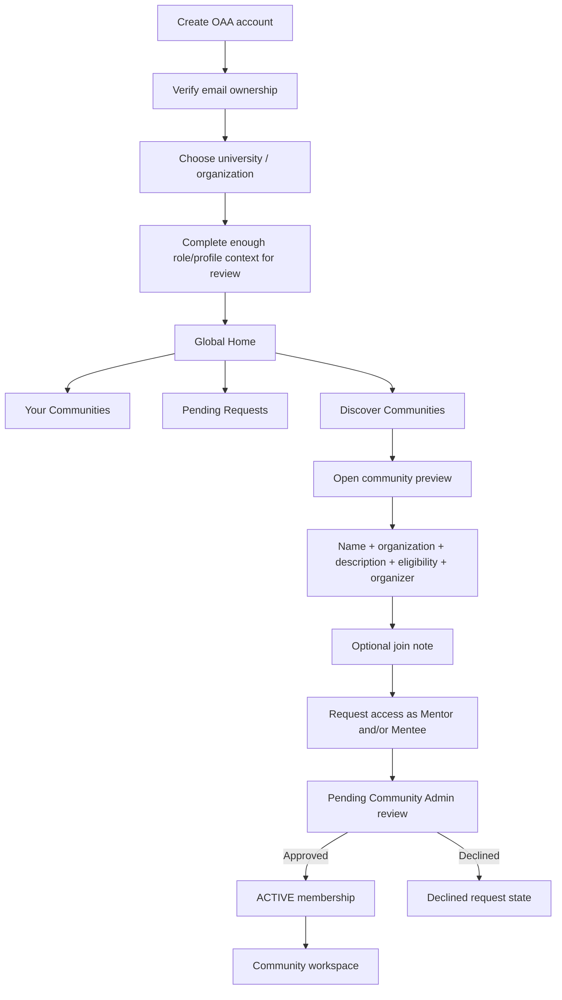
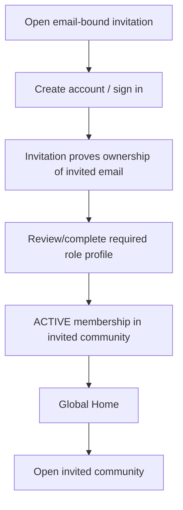
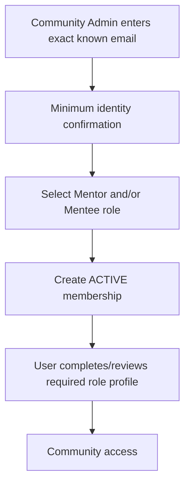
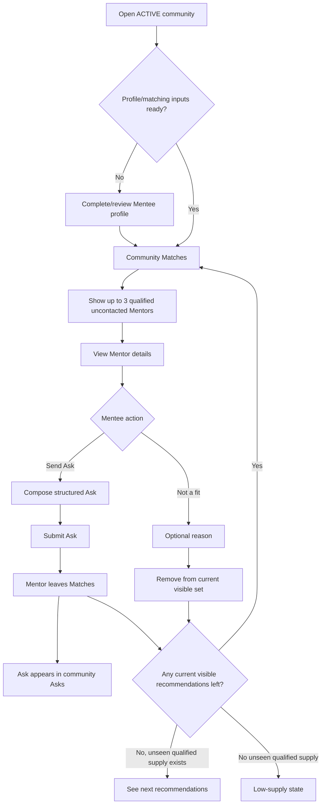
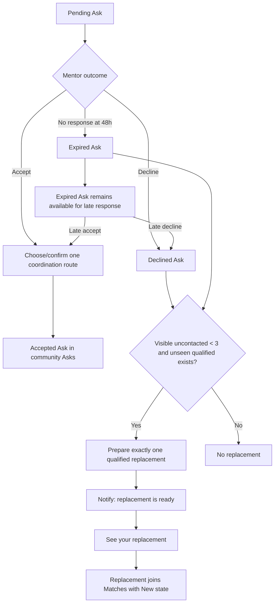
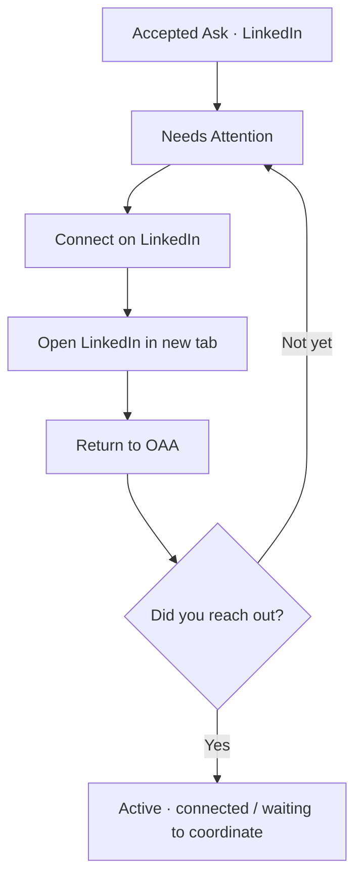
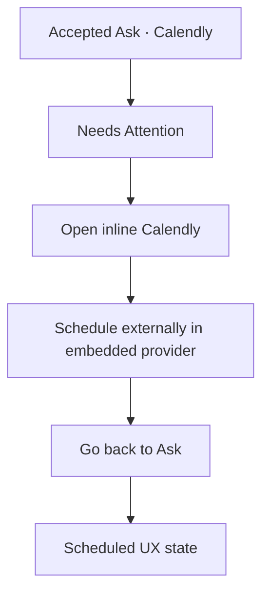
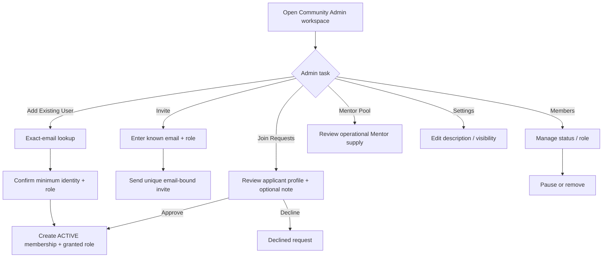
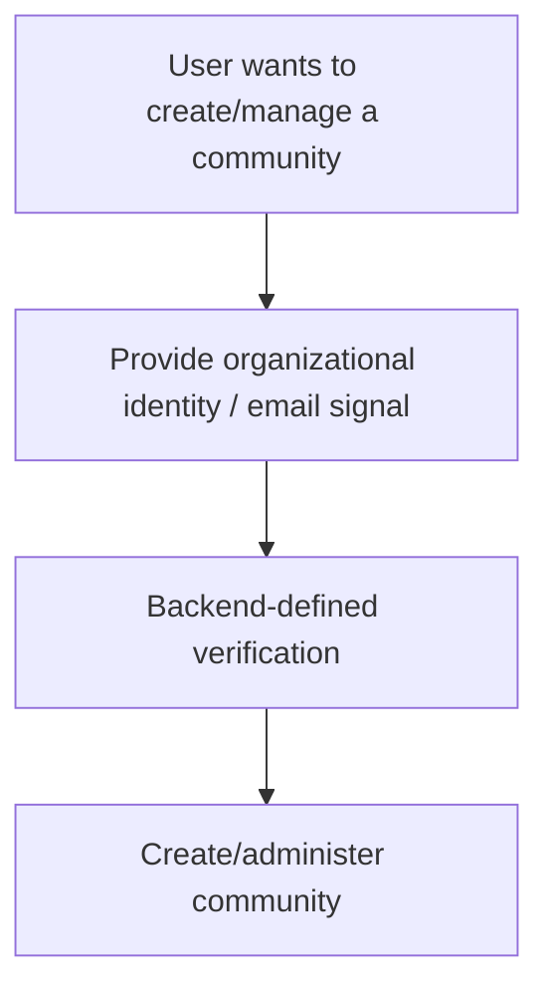

# Community-Enabled User Flows

Last updated: 2026-10-14

**Primary readers:** PM, Product Designer, Frontend, Backend
**Priority:** Highest
**Read this when:** You are designing entry, discovery, membership review, Mentor/Mentee matching, or Admin flows.

## Shared Entry Rules

- both Mentors and Mentees may use open signup
- every user verifies email ownership before product access
- free-entry users select an organization to scope normal community discovery
- organization selection does not itself verify affiliation or grant membership
- a user may hold Mentor, Mentee, or both capabilities over time
- all mentoring activity is scoped to an active community
- normal discovery is organization-scoped
- explicit Admin invite/add may cross organization boundaries
- cross-program membership is allowed subject to Community Admin approval
- cross-community matching is not allowed

## Free-Entry User Flow

## Invited User Flow

An invitation grants only the named community/role. The user may still use normal organization-scoped discovery for other communities.

## Existing-Account Admin Add

The lookup is exact-email only and must not expose a global people directory.

## Global Home

The global Home is the membership/discovery hub.

It contains:

- `Your Communities`
- `Pending Requests`
- `Discover Communities`

Global navigation contains:

- Home
- Notifications
- Profile
- active-community shortcuts

There is no separate canonical global Match list or global Ask history.

## Mentee Community Flow

Low-supply state:

- no relevant recommendations available right now
- more Mentors may be added later
- optional `Review priorities`
- no forced priority change
- no cross-community fallback

## Mentor Outcome And Replacement Flow

A late response does not remove a replacement already prepared/revealed.

## Accepted LinkedIn Flow

## Accepted Calendly Flow

Calendly client scheduled events may also update the UX state. This is not server-verified booking infrastructure.

## Community Admin Membership Flow

Admin may review saved applicant context needed for admission but not private mentoring behavior.

## Community Creation Direction

The intended direction is user-facing Community Admin/community creation rather than permanent backend-only provisioning.

Conceptually:

The exact verification and authority mechanism remains open. Do not invent a minimum Mentor-count gate.

## Prohibited Paths

- no silent cross-community Mentor recommendations
- no public auto-join community mode
- no participant-facing Mentee directory
- no global browseable people directory
- no institutional verification claim from self-selected affiliation alone
- no forced priority change to compensate for low supply
