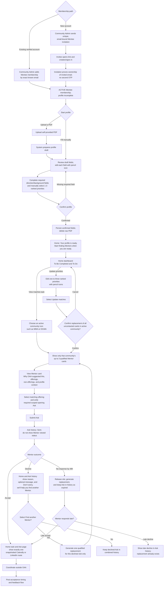
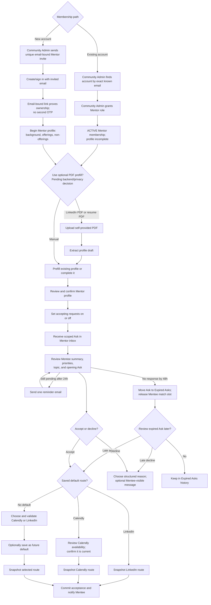
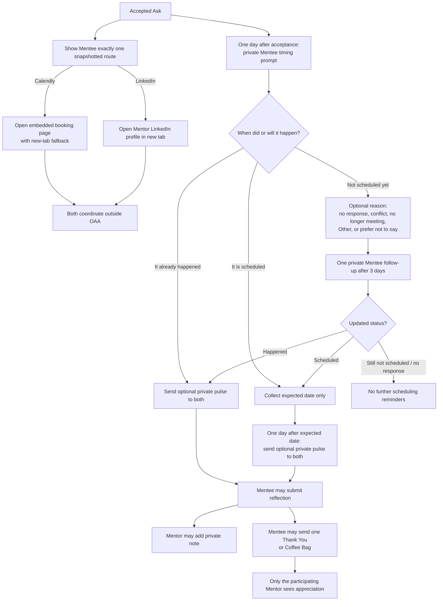
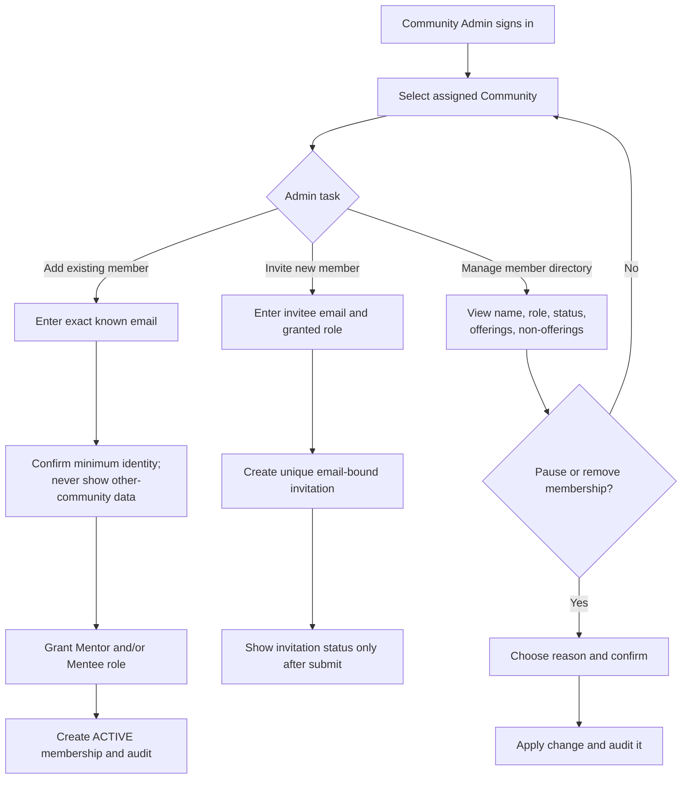

# Community-Enabled User Flows

Last updated: 2026-10-04

**Primary readers:** PM, Product Designer, Frontend, Backend
**Priority:** Highest
**Read this when:** You are designing routes, onboarding, membership review, Mentor/Mentee matching, or admin authorization.

## Current Flow Review

The documented email-verification flow reflects the Community model. The current application UI does not yet:

- routes and components still use exclusive Student/Alumnus terminology
- route groups do not carry a community context
- role selection treats Student and Alumnus as mutually exclusive
- there is no Community Admin member-add flow, email-bound invitation flow, or Community Admin flow
- current availability-slot and native call screens conflict with the accepted-Ask coordination boundary

The flows below are the target MVP behavior. They supersede old UI flow assumptions, not existing production code.

## Shared Entry Rules

- every user verifies ownership of their email before community access
- community access is granted only through a Community Admin adding an existing verified account or sending a unique email-bound invitation
- an email-bound invitation is unique and bound to one normalized email; accepting it proves ownership of that email and does not require a second OTP
- a user may hold Mentor and Mentee roles; do not force one exclusive role selection at account level
- current community is explicit in every authenticated community flow
- optional PDF prefill is shown as a pending branch only; manual completion remains the required fallback until backend, privacy, and agreement terms are approved

## Mentee Access And Ask Flow

**Mentee visibility boundary:** the community icon rail is not a member directory. A Mentee can access only their own Home, Profile, Ask history, and eligible Mentor cards; they cannot see, search, browse, or open another Mentee's profile.

## Mentor Join And Accept Flow

## After Acceptance And Conversation Flow

`Accepted` never expires because a booking signal is absent. OAA does not track Calendly booking, cancellation, rescheduling, call attendance, or no-shows in MVP; all timing and pulse signals above are private self-report.

## Community Admin Flow

## Prohibited Admin Paths

Community Admin must never have a route or API response that reveals:

- stored personal email or email-verification data
- private Mentee/Mentor pulse answers, reflection, Mentor notes, or appreciation notes
- self-reported scheduling status, expected date, or coordination route
- members or private data from another community
- Community metrics in MVP

## Deferred Flow

Cross-community Mentor discovery is deliberately not shown here. It needs a separate product decision on opt-in, scouting-card fields, invitation semantics, and privacy before becoming a user flow.

Platform-admin UI, self-service community creation, and Community Admin assignment are also post-MVP. For the beta, the backend team performs those bootstrap actions from an OAA-approved instruction and records an audit event.
